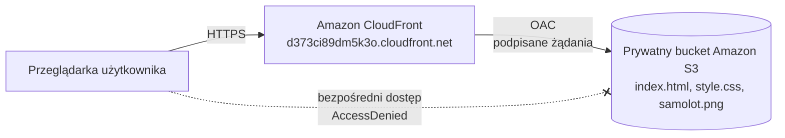

# AI w detekcji dronów

Projekt zaliczeniowy: statyczna strona internetowa o wykorzystaniu sztucznej
inteligencji w wykrywaniu dronów w systemach wojskowych, hostowana w AWS
(Amazon S3 + Amazon CloudFront).

**Adres strony:** https://d373ci89dm5k3o.cloudfront.net

---
## Technologie

- HTML5, CSS3, JavaScript (tylko blokada przewijania do kliknięcia w celownik)
- Czcionki: Anybody, Open Sans (Google Fonts)
- Hosting: Amazon S3 (prywatny bucket) + Amazon CloudFront z Origin Access Control (OAC)

## Uruchomienie lokalne

1. Pobierz repozytorium i rozpakuj.
2. Otwórz plik `index.html` w przeglądarce (dwuklik).

## Architektura

### Rola usług

- **Amazon S3** przechowuje pliki strony. Bucket jest **prywatny**
  (włączone *Block all public access*), więc pliki nie są dostępne bezpośrednio z internetu.
- **Amazon CloudFront** jest jedynym publicznym punktem dostępu do strony.
  Dostarcza pliki przez **HTTPS** (HTTP jest przekierowywany na HTTPS),
  przechowuje ich kopie w pamięci podręcznej (cache) na serwerach brzegowych
  i serwuje `index.html` jako stronę domyślną (**Default root object**).

## Wdrożenie w AWS

### 1. Bucket S3
1. Konsola AWS → **S3** → **Create bucket**.
2. Nazwa: `ai-w-detekcji-dronow`, region: `Europe (Stockholm) eu-north-1 `.
3. Pozostawiono zaznaczone **Block all public access**.
4. **Create bucket**.
5. W buckecie: **Upload** → `index.html`, `style.css`, `samolot.png`
   (w głównym katalogu bucketu).

### 2. Dystrybucja CloudFront z OAC
1. Konsola AWS → **CloudFront** → **Create distribution**.
2. Distribution type: **Single website or app**, bez własnej domeny.
3. Origin type: **Amazon S3** → **Browse S3** → wybór bucketu.
4. Zaznaczono **Allow private S3 bucket access to CloudFront (Recommended)**,
   co tworzy OAC i automatycznie dodaje bucket policy.
5. Ustawienia origin i cache: rekomendowane.
6. WAF: nie włączono.
7. **Create distribution**.

### 3. Ustawienia po utworzeniu
1. Dystrybucja → **General → Settings → Edit** → **Default root object:** `index.html`.
2. **Behaviors** → **Viewer protocol policy:** *Redirect HTTP to HTTPS*.
3. Weryfikacja: S3 → bucket → **Permissions → Bucket policy** zawiera
   uprawnienie dla `cloudfront.amazonaws.com`.
4. Po zmianie statusu z *Deploying* strona jest dostępna pod
   **Distribution domain name**.

## Testy i weryfikacja

### 1. HTTPS i ładowanie zasobów
Strona działa przez HTTPS – połączenie jest szyfrowane, a wpisanie adresu
z `http://` przekierowuje na `https://` 

### 2. Prywatny bucket S3
Otwarcie pliku `index.html` bezpośrednio przez publiczny URL obiektu S3 zwraca
błąd **AccessDenied**, a ta sama strona przez CloudFront działa. Potwierdza to,
że bucket jest prywatny, a dostęp do plików ma wyłącznie CloudFront dzięki OAC.

### 3. Brakujący plik
Nieistniejący adres zwraca kod **403 AccessDenied**.

## 7. Aktualizacja treści i cache CloudFront
1. Zmieniono tekst w `index.html` i wgrano plik do S3.
2. Po odświeżeniu strona przez CloudFront nadal pokazywała starą wersję (przechowywanie kopii w cache).
3. Wykonano invalidation: CloudFront → Invalidations →
   Create invalidation → Object paths: `/*`.
4. Po zakończeniu nowa wersja była widoczna.

